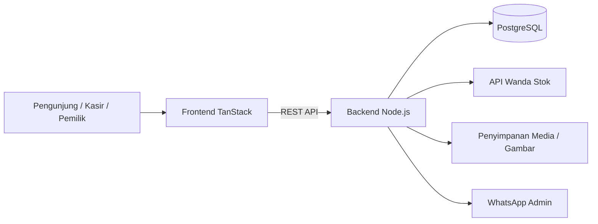
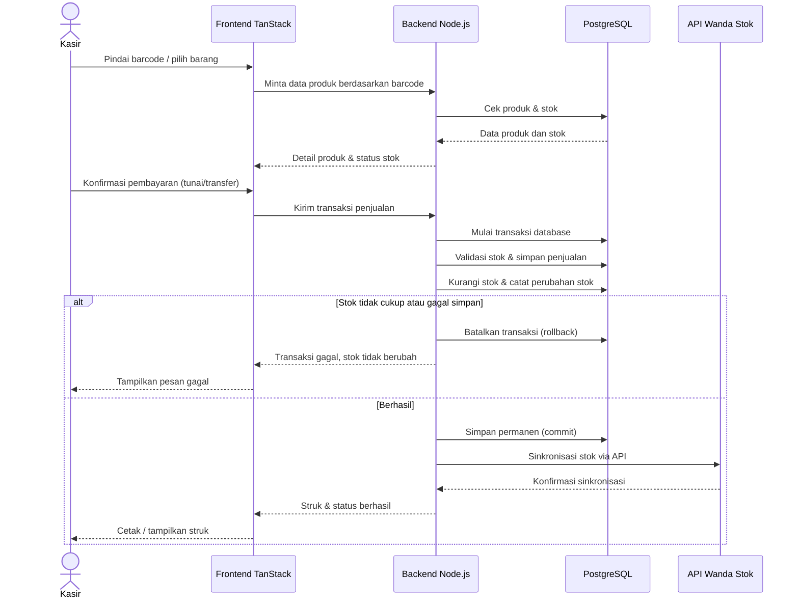
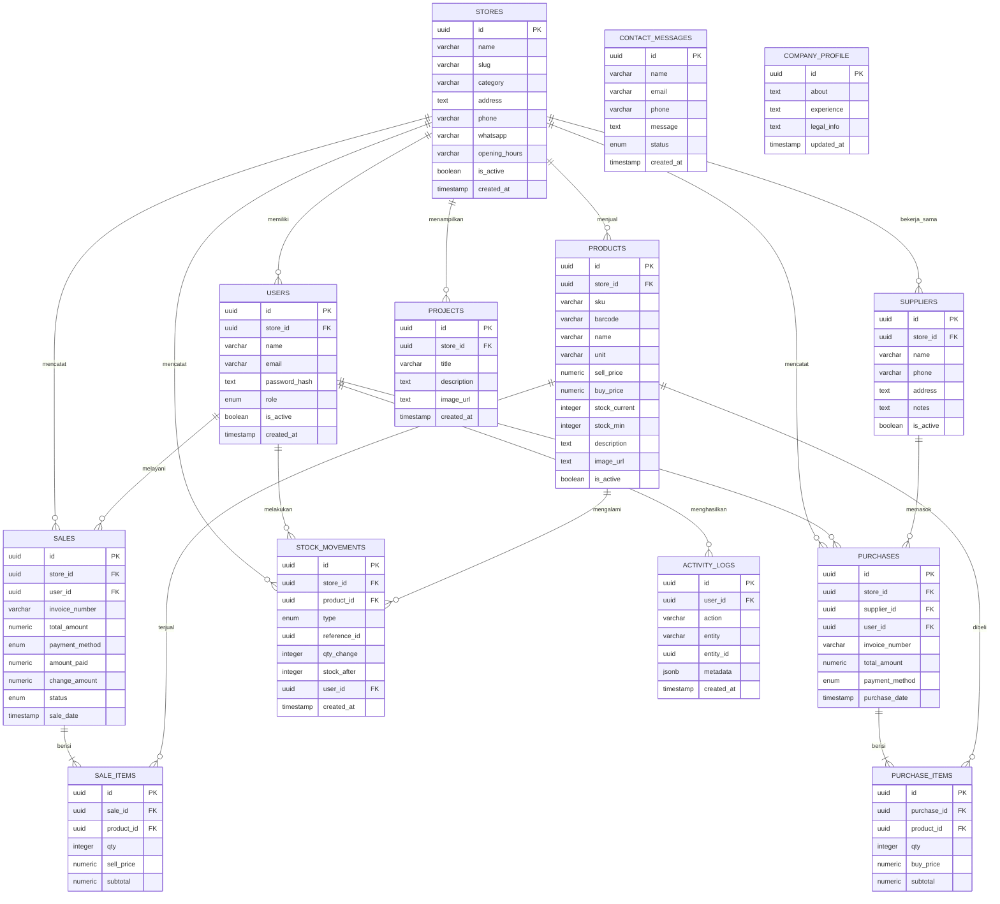

# PRD — Project Requirements Document

## 1. Overview

**Dewandra Grup** adalah website terpusat untuk mengelola dan memperkenalkan lima unit toko milik satu pemilik usaha: **toko pupuk, bangunan, ATK, listrik, dan furniture**.

**Masalah yang diselesaikan:**
- Pemilik harus memeriksa catatan tiap toko secara manual untuk mengetahui penjualan, pembelian, dan stok.
- Pencatatan transaksi dan pencatatan stok masih terpisah (buku, Excel, atau aplikasi berbeda), sehingga rawan selisih antara stok tercatat dan stok fisik.
- Pemilik sulit melihat nilai persediaan, total penjualan, dan total pembelian tiap toko secara cepat.
- Pelanggan belum punya satu tempat untuk melihat layanan, produk, dan menghubungi perusahaan dengan mudah.

**Tujuan utama:**
1. Menyediakan **kasir digital** yang memudahkan pencatatan penjualan lewat pindai barcode atau input manual, dengan pengurangan stok otomatis.
2. Menyediakan **dashboard pemilik** yang menampilkan ringkasan seluruh toko dalam satu layar.
3. Menyediakan **katalog produk publik** dan **halaman profil perusahaan** sebagai etalase digital yang lebih lengkap dibanding kompetitor.
4. Memastikan **transaksi yang gagal tidak mengurangi stok**, dan setiap perubahan stok dapat ditelusuri.
5. Memudahkan pelanggan menghubungi perusahaan melalui **tombol WhatsApp** dan formulir kontak.

**Keunggulan yang ingin ditonjolkan:** website ini lebih lengkap karena menggabungkan etalase layanan, katalog produk, profil perusahaan, galeri proyek, dan saluran kontak dalam satu tempat.

---

## 2. Requirements

### Kebutuhan Fungsional
- **Multi-toko:** sistem mendukung lima toko dengan identitas, produk, stok, dan transaksi yang terpisah.
- **Katalog publik:** pengunjung dapat mencari barang, menyaring berdasarkan toko, melihat detail produk, dan status ketersediaan stok.
- **Kasir:** mencatat penjualan melalui pindai barcode atau input manual, mengatur keranjang, memilih metode pembayaran tunai/transfer, mencetak struk, dan membatalkan transaksi tanpa mengubah stok.
- **Stok otomatis:** stok berkurang saat penjualan berhasil dan bertambah saat pembelian dari pemasok disimpan.
- **Dashboard pemilik:** ringkasan penjualan, pembelian, nilai persediaan, grafik tren, serta filter toko dan periode.
- **Profil & kontak:** profil perusahaan, galeri proyek, formulir kontak, tombol WhatsApp, serta lokasi dan jam buka tiap toko.
- **Riwayat transaksi:** daftar penjualan dan pembelian per toko dengan filter tanggal/toko, detail transaksi, dan jejak perubahan stok.
- **Akun & hak akses:** pemilik melihat semua toko, kasir hanya melihat tokonya sendiri; ada fitur kelola pengguna dan pencatatan aktivitas penting.
- **Integrasi stok:** sinkronisasi perubahan stok melalui API dengan **Wanda Stok** agar data persediaan tetap selaras.

### Kebutuhan Non-Fungsional
- **Konsistensi data:** penjualan dan pengurangan stok dijalankan dalam satu transaksi database (ACID) agar tidak terjadi stok minus atau data setengah jadi.
- **Keamanan:** kata sandi disimpan terenkripsi, sesi login aman, akses dibatasi berdasarkan peran, dan aktivitas penting dicatat.
- **Kinerja:** halaman katalog dan kasir merespons cepat (target di bawah 2 detik pada penggunaan normal).
- **Responsif:** tampilan nyaman dipakai di komputer kasir maupun ponsel pemilik.
- **Skalabilitas & operasional:** aplikasi dijalankan dengan Docker agar mudah dipasang, dipindahkan, dan dicadangkan.
- **Ketersediaan data:** tersedia mekanisme backup database PostgreSQL secara berkala.

### Batasan & Asumsi
- Setiap toko memiliki akun kasirnya sendiri dan hanya boleh mengakses data tokonya.
- Transaksi yang gagal atau dibatalkan tidak boleh memengaruhi jumlah stok maupun laporan penjualan.
- Konten profil perusahaan dan galeri proyek dikelola oleh pemilik/admin.

---

## 3. Core Features

### Fase 1 — Fondasi Publik & Kasir

**1. Beranda Layanan** *(prioritas tinggi)*
Halaman pembuka yang langsung memperlihatkan lima layanan toko dan sekilas profil perusahaan.
- **Hero & Navigasi** — tampilan pembuka dengan menu yang mengarah ke seluruh bagian website.
- **Daftar Lima Layanan** — penjelasan singkat toko pupuk, bangunan, ATK, listrik, dan furniture dalam satu halaman.
- **Sorotan Profil Singkat** — cerita perusahaan dan alasan pelanggan memilih Dewandra Grup.
- **Tombol Hubungi Cepat** — satu klik untuk langsung menghubungi admin lewat WhatsApp.

**2. Katalog Produk** *(prioritas tinggi)*
Menelusuri barang tiap toko lengkap dengan harga dan ketersediaan stoknya.
- **Pencarian Barang** — cari barang dengan nama atau kode barang.
- **Filter per Toko** — menyaring barang hanya dari toko yang diinginkan.
- **Detail Produk** — melihat harga, satuan, dan keterangan singkat tiap barang.
- **Status Stok** — penanda jelas apakah barang tersedia atau habis.

**3. Kasir Transaksi** *(prioritas tinggi)*
Mencatat penjualan dengan cepat, stok langsung berkurang.
- **Pindai Barcode** — menambahkan barang ke keranjang dengan memindai barcode.
- **Input Manual Barang** — mencari dan menambahkan barang tanpa barcode.
- **Keranjang & Total** — mengatur jumlah barang dan melihat total belanja saat itu juga.
- **Pembayaran Tunai & Transfer** — mencatat metode bayar dan jumlah uang diterima.
- **Struk & Pembatalan** — mencetak bukti transaksi; transaksi gagal tidak mengurangi stok.

### Fase 2 — Pemantauan & Etalase Perusahaan

**4. Dashboard Pemilik** *(prioritas tinggi)*
Ringkasan penjualan, pembelian, dan nilai stok kelima toko dalam satu layar.
- **Ringkasan Semua Toko** — total penjualan, pembelian, dan stok tiap toko tampil berdampingan.
- **Grafik Tren** — melihat naik-turun penjualan per hari atau per bulan.
- **Nilai Persediaan** — perkiraan nilai barang tersimpan di masing-masing toko.
- **Pilih Toko & Periode** — mengatur tampilan sesuai toko dan rentang tanggal.

**5. Profil & Kontak** *(prioritas sedang)*
Mengenalkan perusahaan lewat profil, galeri proyek, dan saluran kontak yang mudah dihubungi.
- **Profil Perusahaan** — cerita usaha, pengalaman, dan informasi legal.
- **Galeri Proyek** — kumpulan foto proyek dan pesanan yang pernah dikerjakan.
- **Formulir Kontak** — pengunjung mengirim pesan langsung dari website.
- **Tombol WhatsApp** — chat cepat ke admin penjualan tanpa menyalin nomor.
- **Lokasi & Jam Buka** — alamat dan jam operasional tiap toko tampil jelas.

### Fase 3 — Operasional Stok & Akun

**6. Stok & Pembelian** *(prioritas sedang)*
Mencatat barang masuk dari pemasok sehingga stok naik dengan sendirinya.
- **Catat Pembelian** — memasukkan barang yang dibeli beserta harga belinya.
- **Daftar Pemasok** — menyimpan data pemasok tiap toko.
- **Stok Bertambah Otomatis** — stok langsung bertambah saat pembelian disimpan.
- **Peringatan Stok Menipis** — memberi tanda barang yang perlu segera dibeli lagi.
- **Penyesuaian Stok** — mengoreksi jumlah stok setelah pengecekan fisik.

**7. Riwayat Transaksi** *(prioritas sedang)*
Menelusuri kembali semua transaksi dan perubahan stok per toko.
- **Daftar Transaksi** — semua penjualan dan pembelian tiap toko terkumpul.
- **Filter Tanggal & Toko** — menyaring riwayat sesuai toko dan rentang waktu.
- **Detail Transaksi** — melihat barang, jumlah, metode bayar, dan kasir.
- **Jejak Perubahan Stok** — mengetahui kapan dan karena apa stok berubah.

**8. Akun & Hak Akses** *(prioritas sedang)*
Mengatur siapa yang boleh masuk dan toko mana yang bisa dilihatnya.
- **Masuk & Keluar** — pemilik dan kasir masuk dengan akun masing-masing yang aman.
- **Peran Pengguna** — pemilik melihat semua toko, kasir hanya tokonya sendiri.
- **Kelola Pengguna** — menambah atau menonaktifkan akun kasir saat pergantian staf.
- **Keamanan Data** — mencatat aktivitas penting dan menjaga data transaksi.

---

## 4. User Flow

### A. Pengunjung (Fase 1 & 2)
1. Membuka website Dewandra Grup.
2. Langsung melihat **daftar lima layanan toko** di beranda (kemenangan pertama).
3. Menekan salah satu layanan untuk melihat **katalog produk** toko tersebut.
4. Mencari barang dengan nama/kode atau menyaring berdasarkan toko.
5. Melihat detail produk: harga, satuan, keterangan, dan status stok.
6. Membaca **profil perusahaan** dan melihat **galeri proyek**.
7. Menghubungi admin melalui **tombol WhatsApp** atau **formulir kontak**.
8. Melihat **lokasi dan jam buka** toko yang ingin dikunjungi.

### B. Kasir (Fase 1 & 3)
1. Masuk ke sistem dengan akun kasir milik tokonya.
2. Membuka menu **Kasir Transaksi**.
3. Memindai barcode barang atau mencari barang secara manual.
4. Barang masuk ke keranjang; kasir mengatur jumlah dan melihat total.
5. Memilih metode pembayaran **tunai** atau **transfer**, lalu memasukkan jumlah uang diterima.
6. Menyimpan transaksi → stok berkurang otomatis dan perubahan stok tercatat.
7. Mencetak atau menampilkan **struk**.
8. Bila transaksi gagal/dibatalkan → stok **tidak berubah** dan tidak masuk laporan penjualan.
9. (Fase 3) Mencatat **pembelian dari pemasok** → stok bertambah otomatis.
10. (Fase 3) Melakukan **penyesuaian stok** setelah pengecekan fisik.

### C. Pemilik (Fase 2 & 3)
1. Masuk dengan akun pemilik.
2. Membuka **Dashboard Pemilik** dan melihat ringkasan kelima toko.
3. Memilih toko dan periode tertentu.
4. Melihat grafik tren penjualan serta nilai persediaan.
5. Membuka **Riwayat Transaksi** untuk menelusuri detail transaksi dan jejak perubahan stok.
6. Mengelola akun kasir: menambah, menonaktifkan, atau mengatur tokonya.
7. Memantau aktivitas penting melalui catatan keamanan data.

---

## 5. Architecture

Sistem dibagi menjadi tiga lapisan utama yang dijalankan dalam container Docker:

- **Frontend (TanStack):** menampilkan beranda, katalog, kasir, dashboard, profil, dan formulir kontak. Berkomunikasi dengan backend melalui REST API.
- **Backend (Node.js):** menangani logika bisnis — validasi transaksi, pengurangan/penambahan stok, hak akses, laporan, dan integrasi ke API Wanda Stok.
- **Database (PostgreSQL):** menyimpan data toko, produk, transaksi, stok, pengguna, dan konten website.
- **Layanan eksternal:** API **Wanda Stok** untuk sinkronisasi persediaan, serta penyimpanan media untuk foto produk dan galeri proyek.

### Diagram Arsitektur Komponen

### Diagram Alur Transaksi Kasir

**Catatan penting:** seluruh proses penjualan dan pengurangan stok berada dalam satu transaksi database. Jika ada langkah yang gagal, semua perubahan dibatalkan sehingga stok tetap konsisten.

---

## 6. Database Schema

### Tabel Utama

**1. `stores` — data lima toko**
- `id` (UUID, PK) — identitas toko.
- `name` (VARCHAR 120) — nama toko.
- `slug` (VARCHAR 120, unik) — alamat halaman toko di website.
- `category` (VARCHAR 40) — jenis toko: pupuk, bangunan, atk, listrik, furniture.
- `address` (TEXT) — alamat toko.
- `phone` (VARCHAR 30) — nomor telepon.
- `whatsapp` (VARCHAR 30) — nomor WhatsApp admin toko.
- `opening_hours` (VARCHAR 120) — jam buka.
- `is_active` (BOOLEAN) — status aktif toko.
- `created_at` (TIMESTAMP) — waktu data dibuat.

**2. `users` — akun pemilik dan kasir**
- `id` (UUID, PK)
- `store_id` (UUID, FK ke `stores`, boleh kosong untuk pemilik)
- `name` (VARCHAR 120)
- `email` (VARCHAR 160, unik)
- `password_hash` (TEXT) — kata sandi terenkripsi.
- `role` (ENUM: `owner`, `cashier`)
- `is_active` (BOOLEAN)
- `last_login_at` (TIMESTAMP)
- `created_at` (TIMESTAMP)

**3. `products` — barang tiap toko**
- `id` (UUID, PK)
- `store_id` (UUID, FK ke `stores`)
- `sku` (VARCHAR 60) — kode barang, unik per toko.
- `barcode` (VARCHAR 80) — kode barcode.
- `name` (VARCHAR 160)
- `unit` (VARCHAR 20) — satuan (karung, pcs, dus, dll).
- `sell_price` (NUMERIC 14,2) — harga jual.
- `buy_price` (NUMERIC 14,2) — harga beli.
- `stock_current` (INTEGER) — stok saat ini.
- `stock_min` (INTEGER) — batas minimal stok untuk peringatan.
- `description` (TEXT)
- `image_url` (TEXT)
- `is_active` (BOOLEAN)
- `created_at`, `updated_at` (TIMESTAMP)

**4. `suppliers` — data pemasok per toko**
- `id` (UUID, PK)
- `store_id` (UUID, FK ke `stores`)
- `name` (VARCHAR 120)
- `phone` (VARCHAR 30)
- `address` (TEXT)
- `notes` (TEXT)
- `is_active` (BOOLEAN)
- `created_at` (TIMESTAMP)

**5. `purchases` — transaksi pembelian**
- `id` (UUID, PK)
- `store_id` (UUID, FK ke `stores`)
- `supplier_id` (UUID, FK ke `suppliers`)
- `user_id` (UUID, FK ke `users`)
- `invoice_number` (VARCHAR 60, unik)
- `total_amount` (NUMERIC 14,2)
- `payment_method` (ENUM: `cash`, `transfer`)
- `purchase_date` (TIMESTAMP)
- `notes` (TEXT)
- `created_at` (TIMESTAMP)

**6. `purchase_items` — rincian barang pembelian**
- `id` (UUID, PK)
- `purchase_id` (UUID, FK ke `purchases`)
- `product_id` (UUID, FK ke `products`)
- `qty` (INTEGER)
- `buy_price` (NUMERIC 14,2)
- `subtotal` (NUMERIC 14,2)

**7. `sales` — transaksi penjualan**
- `id` (UUID, PK)
- `store_id` (UUID, FK ke `stores`)
- `user_id` (UUID, FK ke `users`) — kasir yang melayani.
- `invoice_number` (VARCHAR 60, unik)
- `total_amount` (NUMERIC 14,2)
- `payment_method` (ENUM: `cash`, `transfer`)
- `amount_paid` (NUMERIC 14,2)
- `change_amount` (NUMERIC 14,2)
- `status` (ENUM: `paid`, `cancelled`)
- `sale_date` (TIMESTAMP)
- `created_at` (TIMESTAMP)

**8. `sale_items` — rincian barang terjual**
- `id` (UUID, PK)
- `sale_id` (UUID, FK ke `sales`)
- `product_id` (UUID, FK ke `products`)
- `qty` (INTEGER)
- `sell_price` (NUMERIC 14,2)
- `subtotal` (NUMERIC 14,2)

**9. `stock_movements` — jejak perubahan stok**
- `id` (UUID, PK)
- `store_id` (UUID, FK ke `stores`)
- `product_id` (UUID, FK ke `products`)
- `type` (ENUM: `sale`, `purchase`, `adjustment`)
- `reference_id` (UUID) — ID transaksi terkait.
- `qty_change` (INTEGER) — positif untuk barang masuk, negatif untuk keluar.
- `stock_after` (INTEGER) — stok setelah perubahan.
- `user_id` (UUID, FK ke `users`)
- `notes` (TEXT)
- `created_at` (TIMESTAMP)

**10. `contact_messages` — pesan dari formulir kontak**
- `id` (UUID, PK)
- `name` (VARCHAR 120)
- `email` (VARCHAR 160)
- `phone` (VARCHAR 30)
- `message` (TEXT)
- `status` (ENUM: `new`, `read`, `replied`)
- `created_at` (TIMESTAMP)

**11. `projects` — galeri proyek**
- `id` (UUID, PK)
- `store_id` (UUID, FK ke `stores`, boleh kosong)
- `title` (VARCHAR 160)
- `description` (TEXT)
- `image_url` (TEXT)
- `created_at` (TIMESTAMP)

**12. `company_profile` — konten profil perusahaan**
- `id` (UUID, PK)
- `about` (TEXT) — cerita singkat usaha.
- `experience` (TEXT) — pengalaman perusahaan.
- `legal_info` (TEXT) — informasi legal.
- `updated_at` (TIMESTAMP)

**13. `activity_logs` — catatan aktivitas penting**
- `id` (UUID, PK)
- `user_id` (UUID, FK ke `users`, boleh kosong)
- `action` (VARCHAR 120) — jenis aktivitas.
- `entity` (VARCHAR 60) — nama data yang terpengaruh.
- `entity_id` (UUID)
- `metadata` (JSONB) — keterangan tambahan.
- `created_at` (TIMESTAMP)

### Diagram Relasi Database

---

## 7. Tech Stack

Proyek ini dibangun di atas template **“Starter Tanstack” v0.1.0 (NgodingPakeAI)** — codebase siap pakai yang sudah berjalan dengan stack yang telah ditentukan. **Stack dikunci**, sehingga tidak ada penggantian atau alternatif teknologi.

- **Frontend:** TanStack — menangani halaman beranda, katalog produk, kasir, dashboard pemilik, profil perusahaan, galeri proyek, dan formulir kontak.
- **Backend:** Node.js — menangani API transaksi, validasi stok, hak akses, laporan, dan integrasi ke API Wanda Stok.
- **Database:** PostgreSQL — menyimpan data lima toko, produk, transaksi, stok, pengguna, dan konten website.
- **Deployment:** Docker — aplikasi dijalankan dalam container sehingga mudah dipasang, dipindahkan, dan dicadangkan.

Karena setup awal (framework, database, autentikasi, dan fitur bawaan template) **sudah tersedia**, implementasi dapat langsung berfokus pada penambahan fitur sesuai roadmap: beranda layanan, katalog produk, kasir transaksi, dashboard pemilik, profil & kontak, stok & pembelian, riwayat transaksi, serta akun & hak akses.